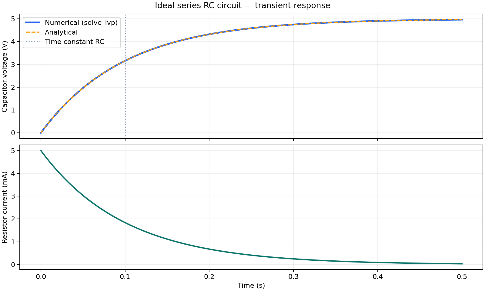

# RC Circuit Lab

RC Circuit Lab shows how a capacitor charges and discharges. Change the resistance, capacitance or starting voltage and see the voltage and current change over time.

The app draws two voltage curves: one from a formula and one calculated step by step. Comparing them makes it easier to check the calculation.



## Run the app

Use Python 3.12. On Windows, run `CAI_DAT.bat`, then `CHAY_DEMO.bat`.

From a terminal:

```bash
python -m pip install -r requirements.txt
python -m streamlit run app.py
```

Once the packages are installed, the app works offline. You can save the values as CSV and the chart as PNG.

## Reading the curves

The time constant is R multiplied by C. A larger value means a slower change. Starting from zero, the capacitor reaches about 63.2% of the source voltage after one time constant, and about 99.3% after five.

During discharge, the current appears negative because it flows against the direction used as the reference. This is expected.

The screen takes capacitance in microfarads and converts it to farads for the calculation.

## Check the results

```bash
python generate_report.py
python -m pip install -r requirements-dev.txt
python -m pytest -q
```

For the two included 5 V examples, the largest difference between the calculated voltage and the formula is below 1.2 × 10⁻⁹ V. The full values and charts are in `reports/`.

This is an ideal circuit model. It does not include component tolerances or measurements from physical hardware.

The calculation is in `circuitlab/simulation.py`; charts are drawn in `plotting.py`. Built with Python, NumPy, SciPy, pandas, Matplotlib and Streamlit. Project code uses the MIT license.
